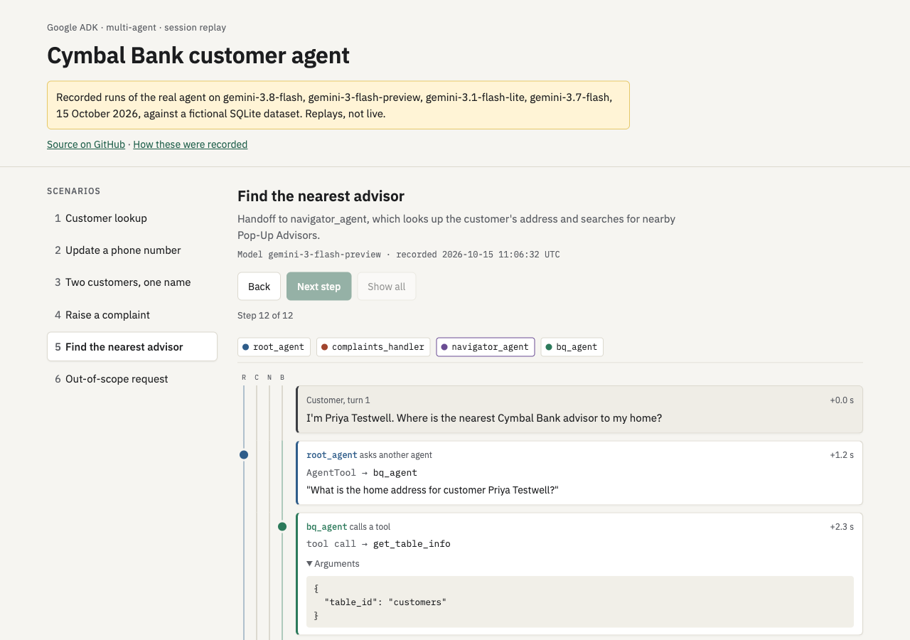
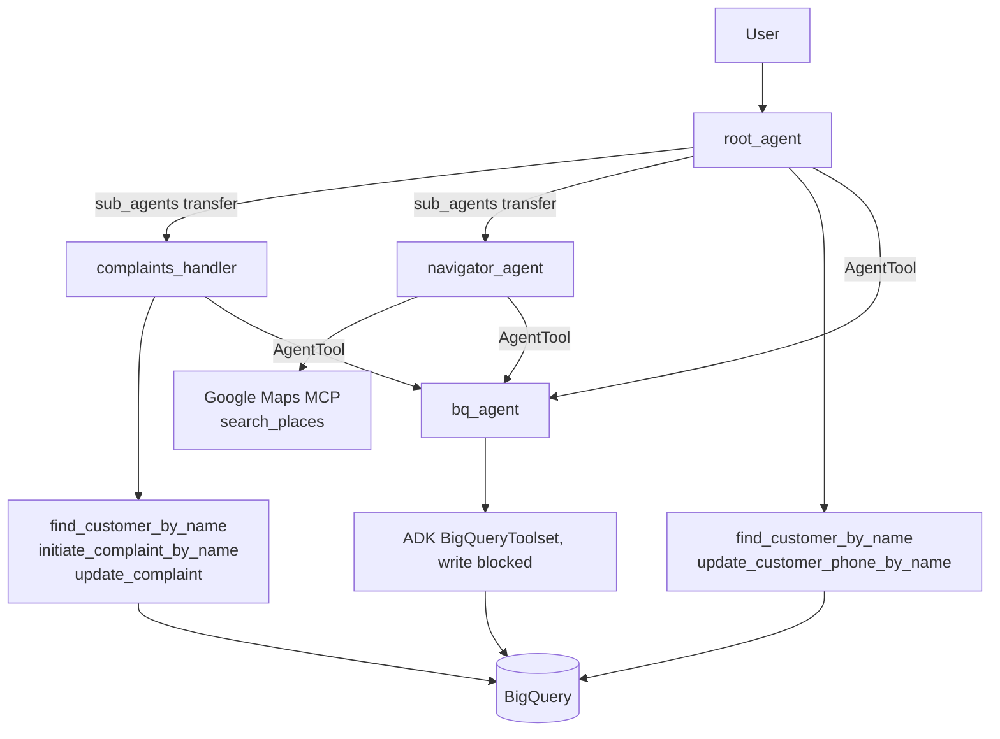

# Banking Multi-Agent System (Google ADK)

[](https://github.com/Ramy3077/banking-multi-agent-adk/actions/workflows/ci.yml)

A customer relationship assistant for a fictional retail bank (Google's "Cymbal Bank" sample data), built on the
[Google Agent Development Kit](https://google.github.io/adk-docs/) with Gemini 2.5 Flash and BigQuery. A root
agent talks to the customer and hands off to a complaints agent or a branch-finder agent.

**Session replays: https://replay-production-b3d5.up.railway.app**

[](https://replay-production-b3d5.up.railway.app)

The replay page plays back recorded runs of the real agents, step by step: agent transfers, tool calls with their
arguments, tool results and replies, in one lane per agent. They were recorded on 15 October 2026 against a local
SQLite database of made-up customers. They are replays, not a live agent, so the page needs no API key and calls no
model. See [Session replays](#session-replays) for how they were made.

## How it works



- **Delegation.** The root agent lists the complaints and navigator agents in `sub_agents`, so the model
  hands the conversation over to them using ADK's agent transfer.
- **Read access.** `bq_agent` is a separate agent wrapping ADK's `BigQueryToolset` with writes blocked. The
  root, complaints and navigator agents each call it as an `AgentTool` for free-form lookups.
- **Writes.** Writes go through plain Python tools that run BigQuery queries:
  - `update_customer_phone_by_name` changes a customer's phone number (root agent).
  - `initiate_complaint_by_name` and `update_complaint` create and update complaints (complaints agent).
  - Name lookups require exactly one match. Zero or several matches return an error and write nothing.
- **Branch finder.** The navigator uses the Google Maps MCP `search_places` tool. Its prompt says Cymbal
  "branches" are Pop-Up Advisors inside Starbucks, so it searches for Starbucks near the customer's address,
  which it gets from `bq_agent` when the user says "near me".
- **Prompts.** Each agent's system prompt is in its own `PROMPT.md`.

All tool queries use BigQuery query parameters (`@name`, `@cid`, ...), so values from the user or the model are
never spliced into SQL. Only table names, which come from environment config, are interpolated.

## Layout

```
customer_relationship_agent/
  agent.py                      root agent
  backend.py                    BANK_BACKEND and BANK_MODEL switches
  tools.py                      bq_agent, customer lookup and phone update (BigQuery)
  complaints_agent/             complaints agent and its complaint tools (BigQuery)
  navigator_agent/              navigator agent (Maps MCP)
  demo_backend/                 SQLite versions of the same tools, plus seed.sql with fictional data
  information_lookup.evalset.json
scripts/record_sessions.py      runs the scenarios and saves the event traces
demo/                           static replay viewer, recorded sessions, Caddy Dockerfile
tests/                          pytest unit tests, BigQuery mocked, SQLite on a temp file
```

## Run it yourself

```bash
uv sync
```

### Option 1: SQLite demo backend (only a Gemini API key)

```bash
export BANK_BACKEND=sqlite
export GOOGLE_GENAI_USE_VERTEXAI=FALSE
export GOOGLE_API_KEY=your-gemini-api-key
uv run adk web
```

`BANK_BACKEND=sqlite` serves every tool from a local SQLite file, created on first use from
`customer_relationship_agent/demo_backend/seed.sql` at `.demo/bank.db` (set `BANK_SQLITE_PATH` to put it elsewhere).
The seed data is invented: customers such as Alex Example and Sam Sample, the fictional town of Exampleton,
`example.org` emails and phone numbers from Ofcom's range reserved for fiction. What changes in this mode:

- The write tools keep the same names, signatures, docstrings and messages, and use `?` query parameters.
- `bq_agent` keeps its name but wraps three read-only SQL tools (`list_table_ids`, `get_table_info`,
  `execute_sql`) instead of ADK's `BigQueryToolset`. `execute_sql` only accepts `SELECT`/`WITH`, opens the file
  read-only with `PRAGMA query_only`, and returns at most 50 rows.
- The navigator's `search_places` is a local stand-in for the Google Maps MCP tool that returns fictional
  Pop-Up Advisor locations from the seed data, so no Maps key is needed.

All agents use `gemini-2.5-flash` unless you set `BANK_MODEL`, for example if your key cannot use 2.5 Flash.

To re-record the replays: `uv run python scripts/record_sessions.py [scenario-id ...]` with the variables above.

### Option 2: BigQuery (the default)

Environment (a `customer_relationship_agent/.env` file works with `adk web`):

| Variable | Needed for |
| --- | --- |
| `GOOGLE_CLOUD_PROJECT` | BigQuery project |
| `GOOGLE_API_KEY` | Gemini (or configure Vertex AI instead) |
| `GOOGLE_MAPS_API_KEY` | navigator agent only |
| `BQ_DATASET_NAME`, `BQ_LOCATION`, `BQ_CUSTOMER_TABLE`, `BQ_ACCOUNTS_TABLE`, `BQ_TRANSACTIONS_TABLE`, `BQ_COMPLAINTS_TABLE` | optional, default to `cymbal_bank`, `EU`, `customers`, `accounts`, `transactions`, `complaints` |

You also need Application Default Credentials with BigQuery access (`gcloud auth application-default login`).
The complaint tools expect a `complaints` table with `complaint_id`, `customer_id`, `transaction_id`,
`complaint_date`, `category`, `description`, `status` and `resolution_notes`. It is not part of the sample data,
so create it yourself.

```bash
uv run adk web
```

## Session replays

`scripts/record_sessions.py` runs each scenario through ADK's `InMemoryRunner` with the real agents and prompts on
the SQLite backend. A runner plugin saves every event, including the events of `bq_agent`, which runs inside an
`AgentTool` that inherits the parent runner's plugins. Each scenario starts from a fresh copy of the seed database,
and the trace ends with a query of the rows the scenario touched. The JSON is in `demo/sessions/`, and `demo/` is a
plain HTML/JS viewer for it, deployed on Railway as a static site behind Caddy.

| Scenario | Model | What happened in the recording |
| --- | --- | --- |
| Customer lookup | `gemini-3.8-flash` | Root called `bq_agent`, which read the schema and ran three `SELECT`s; root replied with a table of Alex Example's October transactions and pointed out the two identical Gadget Barn charges. |
| Update a phone number | `gemini-3.8-flash` | Root called `update_customer_phone_by_name` once; the database row shows the new number. |
| Two customers, one name | `gemini-3-flash-preview` | `update_customer_phone_by_name` returned the multiple-match error, root asked `bq_agent` to list both records and asked the user which one. Neither row changed. |
| Raise a complaint | `gemini-3.1-flash-lite` | Root transferred to `complaints_handler`, which looked up the customer, checked for open complaints through `bq_agent`, searched for the charge (first in 2023, then found both 2026 transactions), summarised and asked for confirmation, then created the complaint on the second turn. It put both transaction IDs in the single `transaction_id` field. |
| Find the nearest advisor | `gemini-3-flash-preview` | Root got the customer's address from `bq_agent`, transferred to `navigator_agent`, which called `search_places` and returned the Testbury location. |
| Out-of-scope request | `gemini-3.7-flash` | Root declined to recommend shares and offered banking help instead, with no tool calls. |

The project targets `gemini-2.5-flash`, but the API key used for the recordings could no longer use that model
("no longer available to new users"), so the runs used newer Flash and Flash-Lite models through `BANK_MODEL`. The free tier
allows 20 requests per model per day, which is why more than one model appears. Each recording names its model.

## Tests

```bash
uv run pytest
uv run ruff check .
```

The unit tests mock the BigQuery client, so they need no Google Cloud access. They cover:

- the SQL each tool builds, and that user input goes in as query parameters;
- the not-found, multiple-match and missing-argument paths;
- errors from BigQuery being returned as text;
- that the phone and complaint updates wait for the job to finish before reading the affected-row count;
- the agent wiring: the two sub-agents, and that the complaints prompt names tools the agent actually has;
- the SQLite backend against a seeded temp database: the same lookup, update and complaint paths, that injected
  values are stored as data, that `execute_sql` rejects writes, and that `BANK_BACKEND=sqlite` swaps every tool.

CI runs ruff and pytest on every push and pull request.

## Evaluation

`customer_relationship_agent/information_lookup.evalset.json` is an ADK evalset with one case: asking for the
name and phone number behind an email address. It expects the root agent to call `bq_agent` and answer with
the customer's name and phone number. It uses ADK's default criteria (tool trajectory and response match). It
calls a model, so it does not run in CI.

```bash
uv run adk eval customer_relationship_agent customer_relationship_agent/information_lookup.evalset.json
```

Result on 15 October 2026, SQLite backend (which includes the evalset's customer), `gemini-3.8-flash`:
**failed**.

| Metric | Score | Threshold |
| --- | --- | --- |
| `tool_trajectory_avg_score` | 0.0 | 1.0 |
| `response_match_score` | 0.36 | 0.8 |

The agent called `bq_agent`, as expected, and answered with the right name and phone number. The trajectory
metric still scored 0 because it compares tool arguments exactly, and the free-text `request` passed to
`bq_agent` was worded differently from the recorded one. The response metric is a ROUGE overlap, and the answer
was a bulleted list rather than the expected sentence. The raw result is in
[`demo/eval/`](demo/eval/information_lookup.evalset_result.json).

The complaints and navigator agents have no evals.

---

Built by [Ramy Mekhzer](https://github.com/Ramy3077), MEng Computer Science & Software Engineering, University of Birmingham.
