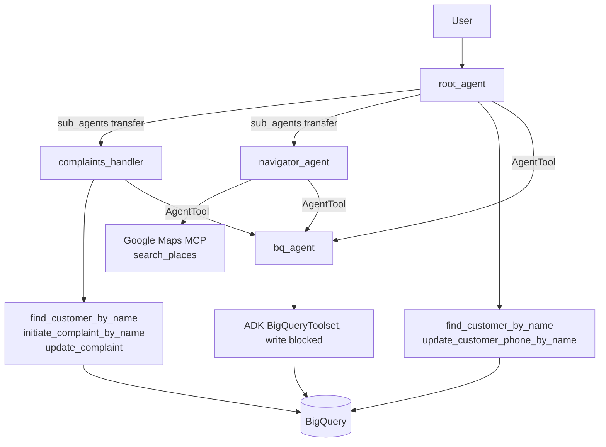

# Banking Multi-Agent System (Google ADK)

[](https://github.com/Ramy3077/banking-multi-agent-adk/actions/workflows/ci.yml)

A customer relationship assistant for a fictional retail bank (Google's "Cymbal Bank" sample data), built on the
[Google Agent Development Kit](https://google.github.io/adk-docs/) with Gemini 2.5 Flash and BigQuery. A root
agent talks to the customer and hands off to a complaints agent or a branch-finder agent.

## How it works



- **Delegation.** The root agent lists the complaints and navigator agents in `sub_agents`, so the model
  hands the conversation over to them using ADK's agent transfer.
- **Read access.** `bq_agent` is a separate agent wrapping ADK's `BigQueryToolset` with writes blocked. The
  root, complaints and navigator agents each call it as an `AgentTool` for free-form lookups.
- **Writes.** Writes go through plain Python tools that run BigQuery queries:
  - `update_customer_phone_by_name` changes a customer's phone number (root agent).
  - `initiate_complaint_by_name` and `update_complaint` create and update complaints (complaints agent).
  - Name lookups require exactly one match. Zero or several matches return an error and write nothing.
- **Branch finder.** The navigator uses the Google Maps MCP `search_places` tool. Its prompt says Cymbal
  "branches" are Pop-Up Advisors inside Starbucks, so it searches for Starbucks near the customer's address,
  which it gets from `bq_agent` when the user says "near me".
- **Prompts.** Each agent's system prompt is in its own `PROMPT.md`.

All tool queries use BigQuery query parameters (`@name`, `@cid`, ...), so values from the user or the model are
never spliced into SQL. Only table names, which come from environment config, are interpolated.

## Layout

```
customer_relationship_agent/
  agent.py                      root agent
  tools.py                      bq_agent, customer lookup and phone update
  complaints_agent/             complaints agent and its complaint tools
  navigator_agent/              navigator agent (Maps MCP)
  information_lookup.evalset.json
tests/                          pytest unit tests, BigQuery mocked
```

## Setup

```bash
uv sync
```

Environment (a `customer_relationship_agent/.env` file works with `adk web`):

| Variable | Needed for |
| --- | --- |
| `GOOGLE_CLOUD_PROJECT` | BigQuery project |
| `GOOGLE_API_KEY` | Gemini (or configure Vertex AI instead) |
| `GOOGLE_MAPS_API_KEY` | navigator agent only |
| `BQ_DATASET_NAME`, `BQ_LOCATION`, `BQ_CUSTOMER_TABLE`, `BQ_ACCOUNTS_TABLE`, `BQ_TRANSACTIONS_TABLE`, `BQ_COMPLAINTS_TABLE` | optional, default to `cymbal_bank`, `EU`, `customers`, `accounts`, `transactions`, `complaints` |

You also need Application Default Credentials with BigQuery access (`gcloud auth application-default login`).
The complaint tools expect a `complaints` table with `complaint_id`, `customer_id`, `transaction_id`,
`complaint_date`, `category`, `description`, `status` and `resolution_notes`. It is not part of the sample data,
so create it yourself.

```bash
uv run adk web
```

## Tests

```bash
uv run pytest
uv run ruff check .
```

The unit tests mock the BigQuery client, so they need no Google Cloud access. They cover:

- the SQL each tool builds, and that user input goes in as query parameters;
- the not-found, multiple-match and missing-argument paths;
- errors from BigQuery being returned as text;
- that the phone and complaint updates wait for the job to finish before reading the affected-row count;
- the agent wiring: the two sub-agents, and that the complaints prompt names tools the agent actually has.

CI runs ruff and pytest on every push and pull request.

## Evaluation

`customer_relationship_agent/information_lookup.evalset.json` is an ADK evalset with one case: asking for the
name and phone number behind an email address. It expects the root agent to call `bq_agent` and answer with
the customer's name and phone number. It uses ADK's default criteria (tool trajectory and response match) and
needs the live BigQuery dataset, so it does not run in CI.

```bash
uv run adk eval customer_relationship_agent customer_relationship_agent/information_lookup.evalset.json
```

The complaints and navigator agents have no evals.

---

Built by [Ramy Mekhzer](https://github.com/Ramy3077), MEng Computer Science & Software Engineering, University of Birmingham.
